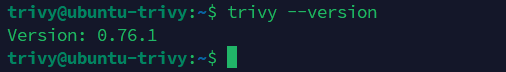
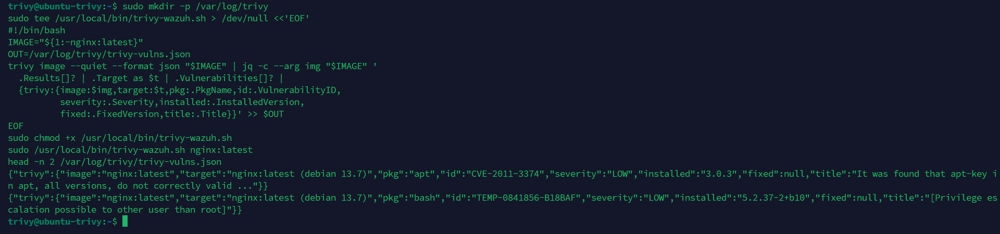
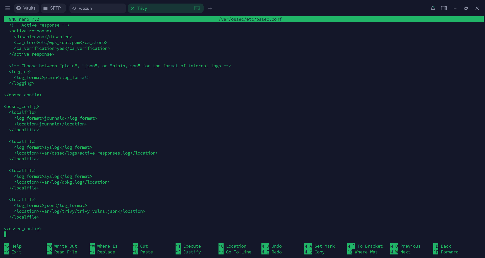
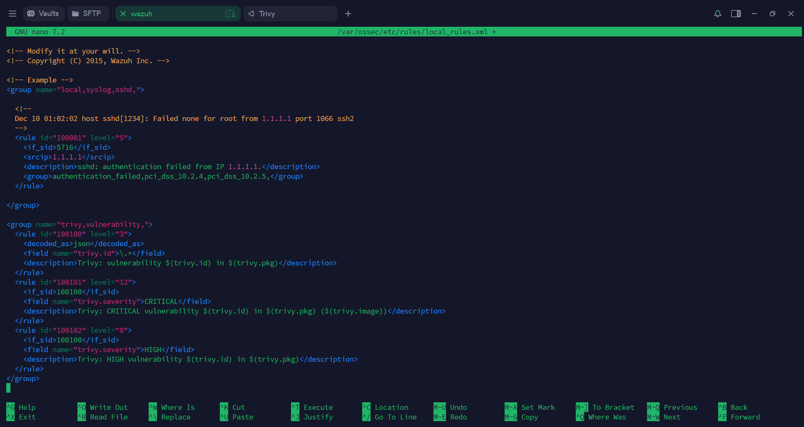
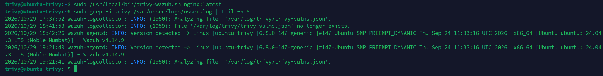
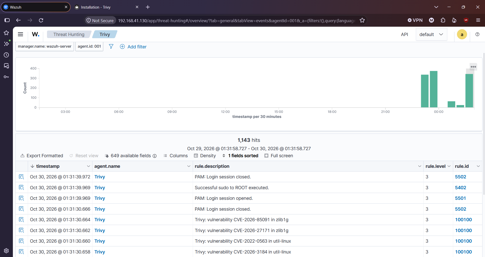

# Trivy + Wazuh Integration

Scan container images with **Trivy**, ship the results to **Wazuh**, and turn them into searchable alerts on the Wazuh dashboard.

  

## Overview

Trivy scans containers, filesystems and repositories for vulnerabilities and can output JSON. The Wazuh agent reads that JSON file with a `localfile` block, and the Wazuh manager converts each line into an alert using custom rules.

```
Trivy scan -> JSON log file -> Wazuh agent -> Wazuh manager rules -> Dashboard
```

## Lab Environment

| Component | Details |
|---|---|
| Agent machine | Ubuntu 24.04 LTS (hostname `ubuntu-trivy`) |
| Trivy | 0.76.1 |
| Wazuh | 4.14.9 (manager + dashboard) |
| Scan target | `nginx:latest` |

## Prerequisites

- A working Wazuh manager and dashboard
- A Wazuh agent installed and connected on the Ubuntu machine
- `sudo` access on both the agent and the manager

---

## Step 1: Install Trivy on the agent machine

```bash
sudo apt-get install wget gnupg
wget -qO - https://aquasecurity.github.io/trivy-repo/deb/public.key | gpg --dearmor | sudo tee /usr/share/keyrings/trivy.gpg > /dev/null
echo "deb [signed-by=/usr/share/keyrings/trivy.gpg] https://aquasecurity.github.io/trivy-repo/deb generic main" | sudo tee -a /etc/apt/sources.list.d/trivy.list
sudo apt-get update
sudo apt-get install -y trivy jq
trivy --version
```

**Screenshot:** `trivy --version` showing 0.76.1



---

## Step 2: Write a script that saves results as one JSON object per line

Wazuh reads JSON line by line, so Trivy's normal (nested) output has to be flattened first. `jq -c` prints each vulnerability as a single-line JSON object.

```bash
sudo mkdir -p /var/log/trivy
sudo tee /usr/local/bin/trivy-wazuh.sh > /dev/null <<'EOF'
#!/bin/bash
IMAGE="${1:-nginx:latest}"
OUT=/var/log/trivy/trivy-vulns.json
trivy image --quiet --format json "$IMAGE" | jq -c --arg img "$IMAGE" '
  .Results[]? | .Target as $t | .Vulnerabilities[]? |
  {trivy:{image:$img,target:$t,pkg:.PkgName,id:.VulnerabilityID,
          severity:.Severity,installed:.InstalledVersion,
          fixed:.FixedVersion,title:.Title}}' >> $OUT
EOF
sudo chmod +x /usr/local/bin/trivy-wazuh.sh
sudo /usr/local/bin/trivy-wazuh.sh nginx:latest
```

Sample output line:

```json
{"trivy":{"image":"nginx:latest","target":"nginx:latest (debian 13.1)","pkg":"apt","id":"CVE-2011-3374","severity":"LOW","installed":"3.0.3","fixed":null,"title":"It was found that apt-key in apt, all versions, do not correctly valid ..."}}
```

**Screenshot:** script creation and first lines of `trivy-vulns.json`



---

## Step 3: Tell the Wazuh agent to read the file

Add this block inside `<ossec_config>` in `/var/ossec/etc/ossec.conf` on the agent:

```xml
<localfile>
  <log_format>json</log_format>
  <location>/var/log/trivy/trivy-vulns.json</location>
</localfile>
```

Restart the agent:

```bash
sudo systemctl restart wazuh-agent
```

**Screenshot:** `ossec.conf` with the new `localfile` block



---

## Step 4: Automate scans with cron

Run the scan every day at 02:00:

```bash
echo "0 2 * * * root /usr/local/bin/trivy-wazuh.sh nginx:latest" | sudo tee /etc/cron.d/trivy-scan
```

---

## Step 5: Add custom rules on the Wazuh manager

Add the following to `/var/ossec/etc/rules/local_rules.xml`:

```xml
<group name="trivy,vulnerability,">
  <rule id="100100" level="3">
    <decoded_as>json</decoded_as>
    <field name="trivy.id">\.+</field>
    <description>Trivy: vulnerability $(trivy.id) in $(trivy.pkg)</description>
  </rule>
  <rule id="100101" level="12">
    <if_sid>100100</if_sid>
    <field name="trivy.severity">CRITICAL</field>
    <description>Trivy: CRITICAL vulnerability $(trivy.id) in $(trivy.pkg)</description>
  </rule>
  <rule id="100102" level="8">
    <if_sid>100100</if_sid>
    <field name="trivy.severity">HIGH</field>
    <description>Trivy: HIGH vulnerability $(trivy.id) in $(trivy.pkg)</description>
  </rule>
</group>
```

| Rule ID | Level | Matches |
|---|---|---|
| 100100 | 3 | Any Trivy finding (base rule) |
| 100101 | 12 | `CRITICAL` severity |
| 100102 | 8 | `HIGH` severity |

Restart the manager:

```bash
sudo systemctl restart wazuh-manager
```

**Screenshot:** `local_rules.xml` with the Trivy rules



---

## Step 6: Test and verify

**On the agent**, run a scan and check that the Wazuh agent picked up the file:

```bash
sudo /usr/local/bin/trivy-wazuh.sh nginx:latest
sudo grep -i trivy /var/ossec/logs/ossec.log | tail -n 5
```

You should see `wazuh-logcollector: INFO: Analyzing file: '/var/log/trivy/trivy-vulns.json'`.



**On the dashboard**, open **Threat Hunting -> Events** and filter with:

```
rule.groups:trivy
```

Alerts such as `Trivy: vulnerability CVE-2026-65091 in zlib1g` (rule `100100`) should appear.



---

## Troubleshooting

- **Nothing shows up in the dashboard:** check `/var/ossec/logs/ossec.log` on the agent. The most common cause is that the JSON is not one object per line.
- **Rules not firing:** confirm the manager was restarted after editing `local_rules.xml`, and test a sample line with `/var/ossec/bin/wazuh-logtest`.
- **File keeps growing:** the script appends to `trivy-vulns.json` on every run, so consider adding `logrotate` for `/var/log/trivy/`.

## Author

**Md. Jamal Uddin**
Junior SOC Analyst technical assessment, Bengal Infosec Limited
